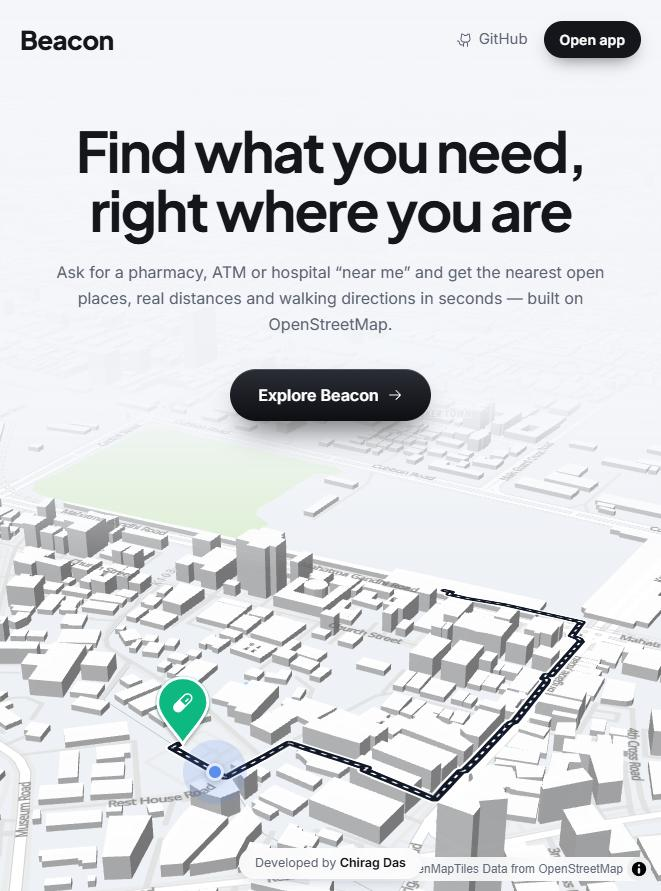
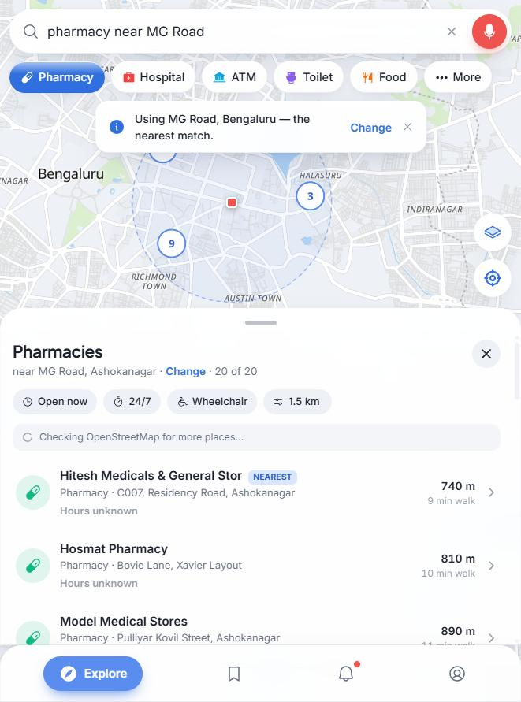
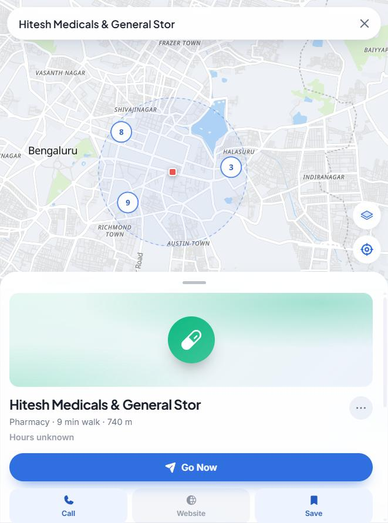
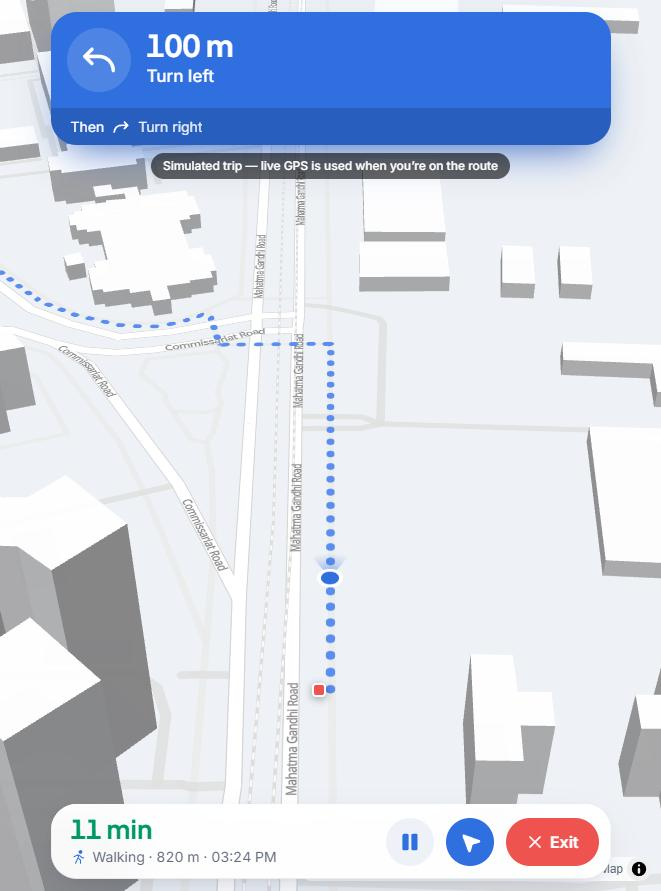

# Beacon

Find what you need, right where you are.

Beacon helps people who are new to a city find the nearest pharmacy, ATM, hospital, washroom or food place that is open right now, using OpenStreetMap data.

**Live app:** https://chiragdascodes.github.io/FSDCIA1/
**Report (PDF):** [docs/Beacon-Report-Chirag-Das.pdf](docs/Beacon-Report-Chirag-Das.pdf)

| | |
|---|---|
| Name | Chirag Das |
| Register No | 2648517 |
| Course | 2 MSc AI ML |
| Subject | FSD CIA 2 |

<p align="center">
  
  
  
  
</p>

## Why I built it

I tested openstreetmap.org and found that "pharmacy near me" returned results from Italy, "MG Road" landed in the wrong city, results had no distance or open status, and a place page had no directions button. Screenshots are in [docs/evidence](docs/evidence).

## What it does

- Understands normal searches like "pharmacy near me" or "atm near MG Road"
- Uses your location, or your city if location is off
- Asks "which one?" when a street name exists in more than one place
- Nearest first, with walking time and "Open · closes 23:30"
- Filters for open now, 24/7 and wheelchair access
- Place card with Go Now, Call, Website, Save and Share
- Directions for walk, cycle and car, with a Start mode like Google Maps
- Voice search, saved places and a form to report wrong info
- 3D globe, Liquid Glass design, works on phone and desktop, installable

## Run it

```bash
npm install
npm run dev
```

Tests: `npm test` (64 passing) · Build: `npm run build`

Every push to `main` runs the tests, builds and deploys to GitHub Pages.

## Built with

React, TypeScript, Vite, Tailwind CSS, MapLibre GL, OpenFreeMap, Phosphor icons. Data from OpenStreetMap through Nominatim, Photon, Overpass and OSRM. The JavaScript asked for in the paper (events, fetch, validation) is in plain `.js` files in [src/js](src/js).

## Limitations

- Most places on OSM have no opening hours yet
- Free map servers can be slow or busy
- No live traffic or public transport
- Navigation needs real GPS; on a laptop it plays a simulated trip

## AI usage

- I chose the problem, the target users and the workflow to improve
- I found the wrong MG Road issue myself while testing OpenStreetMap
- I designed the custom UI in Figma and set the look and feel
- I decided the features and tested every version
- Claude (Anthropic) helped analyse openstreetmap.org, wrote most of the code from my instructions and helped draft the report
- I have reviewed the code and can explain how it works

Map data © OpenStreetMap contributors (ODbL).
